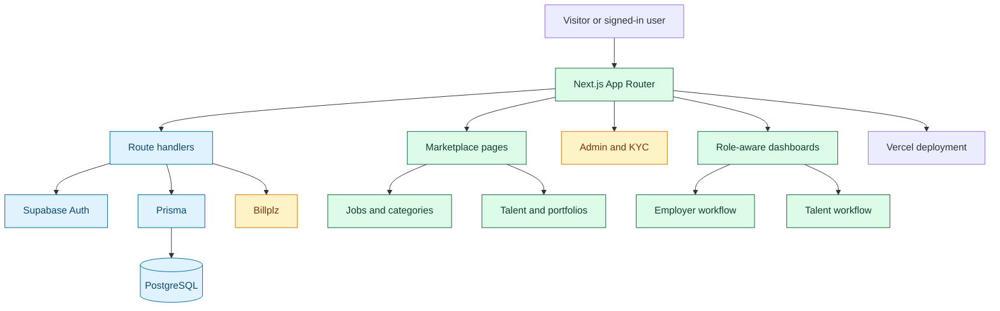
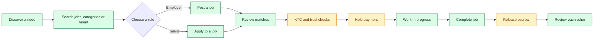
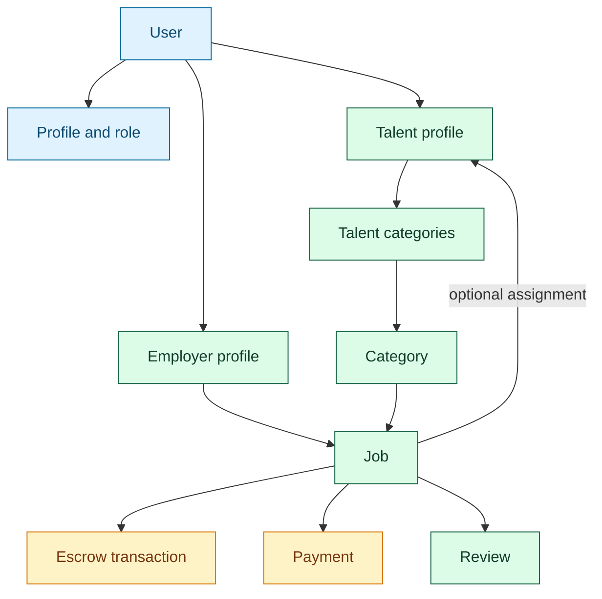
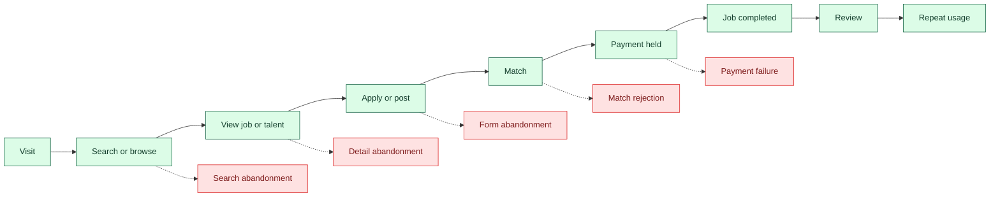

# UpahJe.my — Project Documentation

Last updated: 2026-07-28

## Purpose

UpahJe.my is a Malaysia-first task marketplace for hiring people for practical, local work. The product combines:

- Public marketplace discovery
- Talent profiles and category browsing
- Employer job posting
- Applications and matching surfaces
- MyKad/KYC trust workflow
- Escrow/payment primitives for Billplz
- Admin review surfaces
- Early AI task workflow experiments

The current product direction is broad marketplace positioning: “upah sesiapa untuk apa sahaja”, with trust and safety before scale.

## Tech stack

| Layer | Choice |
| --- | --- |
| Framework | Next.js 14 App Router |
| Language | TypeScript |
| UI | React 18, Tailwind CSS, lucide-react, motion |
| Auth/data | Supabase clients + Prisma models |
| Database | PostgreSQL through Prisma |
| Payments | Billplz integration routes/helpers |
| Deployment | Vercel |

## Platform at a glance



### Marketplace journey



### Core data relationships



## Marketplace analytics

Analytics should answer three questions: **Are people finding relevant work? Are jobs converting? Is the marketplace becoming safer and healthier?**

| Panel | Primary metrics | Product decision supported |
| --- | --- | --- |
| Acquisition | Visitors, source, landing-page conversion, search usage | Which channels and homepage sections work |
| Demand | Jobs posted, category demand, budget distribution, location coverage | Where employer demand exists |
| Supply | Active talent, profile completion, KYC rate, category coverage | Where talent supply is missing |
| Matching | Applications per job, qualified matches, time to first application | Whether discovery and matching work |
| Transaction | Payment starts, holds, releases, cancellations, completion value | Whether jobs become paid outcomes |
| Trust | KYC approval time, disputes, cancellations, review coverage and rating | Whether the marketplace is safe |
| Retention | Repeat employers, repeat talent, 30-day return rate | Whether users receive lasting value |



### North-star and guardrail metrics

**North-star metric:** successfully completed and paid jobs per week.

Supporting metrics:

1. Job-post-to-first-qualified-application time.
2. Match-to-payment conversion rate.
3. Payment-hold-to-completion conversion rate.
4. Median employer and talent response time.
5. KYC completion and approval rate.
6. Repeat transaction rate by cohort.
7. Supply-demand ratio by category and location.

Guardrails:

- Dispute and cancellation rate
- Payment failure rate
- KYC review backlog and turnaround time
- Suspicious duplicate accounts/jobs
- Search results with zero relevant supply

### Event taxonomy

Track consistent, privacy-conscious events rather than page views alone:

```text
search_performed
category_viewed
job_viewed
job_post_started
job_post_completed
application_started
application_submitted
match_viewed
kyc_submitted
kyc_decided
payment_started
payment_held
job_completed
escrow_released
review_submitted
```

Every event should include only the minimum useful dimensions: anonymized user/session ID, role, category, state/area, device class, timestamp, and outcome. Never send MyKad images, secrets, free-form private messages, or payment credentials to analytics.

## Repository map

```text
upahje-my/
├── app/                         Next.js App Router pages, layouts, route handlers
│   ├── page.tsx                 Landing page
│   ├── jobs/                    Browse, detail, post, apply, matches
│   ├── talent/                  Talent directory and profiles
│   ├── categories/              Category discovery pages
│   ├── auth/                    Sign in/up/login routes
│   ├── (onboarding)/            Onboarding flow
│   ├── (app)/dashboard/         Role-aware dashboards
│   ├── admin/                   Admin and KYC review surfaces
│   ├── ai/                      AI task workflow experiment pages
│   └── api/                     Auth, jobs, KYC, payments, escrow, reviews APIs
├── components/                  Shared UI, layout, navigation, jobs, talent, onboarding
├── lib/                         Prisma, Supabase, auth, payment, i18n, sample-data helpers
├── prisma/                      Prisma schema and seed script
├── supabase/migrations/         RLS/security migrations
├── docs/                        Roadmaps, audits, production guides
├── public/                      Static assets
└── package.json                 Build/test/development scripts
```

## Core product surfaces

### Marketplace discovery

Routes:

- `/` — public landing page
- `/jobs` — job browsing with filters/search
- `/jobs/[jobId]` — job detail
- `/categories` and `/categories/[slug]` — vertical/category browsing
- `/talent` and `/talent/[slug]` — talent directory and profile pages
- `/portfolio/[slug]` — portfolio/project detail page

Relevant components:

- `components/ui/HeroNew.tsx`
- `components/ui/LiveJobFeed.tsx`
- `components/navigation/CategoryNav.tsx`
- `components/jobs/ExpandableJobCard.tsx`
- `components/jobs/JobFilters.tsx`
- `components/talent/ExpandableTalentCard.tsx`
- `components/portfolio/PortfolioGrid.tsx`

### Employer and job flow

Routes/APIs:

- `/jobs/post` — employer job-posting page
- `app/jobs/post/PostJobForm.tsx` — job form
- `app/api/jobs/route.ts` — create/list jobs
- `app/api/jobs/[jobId]/route.ts` — job detail/update endpoint
- `app/api/jobs/[jobId]/apply/route.ts` — application endpoint
- `/jobs/[jobId]/matches` — matching surface

### Talent onboarding and KYC

Routes/APIs:

- `/onboarding` — guided role/profile setup
- `app/api/onboarding/complete/route.ts` — persist onboarding result
- `app/api/kyc/upload/route.ts` — upload MyKad/KYC file
- `app/api/kyc/status/route.ts` — KYC status
- `app/api/admin/kyc/route.ts` — admin KYC queue
- `app/api/admin/kyc/[profileId]/route.ts` — admin KYC action

Relevant components:

- `components/onboarding/MyKadUpload.tsx`
- `components/onboarding/employer/EmployerOnboardingSimple.tsx`
- `components/onboarding/shared/TalentProfilePreview.tsx`

### Auth and dashboards

Routes/APIs:

- `/auth/signin`
- `/auth/signup`
- `/auth/login`
- `app/api/auth/me/route.ts`
- `app/api/auth/role/route.ts`
- `/(app)/dashboard`
- `/(app)/dashboard/employer`
- `/(app)/dashboard/talent`

### Payments and escrow

Routes/APIs:

- `/pay/[jobId]`
- `/payment/status`
- `app/api/payments/create/route.ts`
- `app/api/payments/status/route.ts`
- `app/api/payments/webhook/route.ts`
- `app/api/escrow/hold/route.ts`
- `app/api/escrow/release/route.ts`
- `app/api/escrow/cancel/route.ts`

Payment provider: Billplz.

## Data model

Prisma schema: `prisma/schema.prisma`

Main models:

- `User` — identity root
- `Profile` — role, phone/location, KYC status/file
- `Talent` — talent profile, track, rate, verified tier, categories
- `Employer` — employer profile/company and posted jobs
- `Category` — marketplace verticals by track
- `Job` — employer task/job posting with category, talent assignment and status
- `Review` — one review per job
- `EscrowTransaction` — held/released/cancelled escrow state
- `Payment` — payment records linked to jobs

Enums:

- `Role`: `TALENT`, `EMPLOYER`, `ADMIN`
- `KYCStatus`: `PENDING`, `SUBMITTED`, `VERIFIED`, `REJECTED`
- `Track`: `LABOUR`, `TECHNICAL`
- `JobStatus`: `OPEN`, `MATCHED`, `IN_PROGRESS`, `COMPLETED`, `CANCELLED`
- `EscrowStatus`: `HELD`, `RELEASED`, `CANCELLED`

## Environment variables

Required for production/deployment:

```text
NEXT_PUBLIC_SUPABASE_URL
NEXT_PUBLIC_SUPABASE_ANON_KEY
NEXT_PUBLIC_SUPABASE_PUBLISHABLE_KEY
SUPABASE_SERVICE_ROLE_KEY
DATABASE_URL
DIRECT_URL                 # optional direct admin DB URL for maintenance/migrations
NEXTAUTH_SECRET
NEXTAUTH_URL
```

Optional/payment:

```text
GOOGLE_CLIENT_ID
GOOGLE_CLIENT_SECRET
BILLPLZ_API_KEY
BILLPLZ_COLLECTION_ID
BILLPLZ_X_SIGNATURE_KEY
BILLPLZ_X_SIGNATURE        # legacy alias/fallback
BILLPLZ_SANDBOX
```

Security notes:

- Never expose `SUPABASE_SERVICE_ROLE_KEY` in client components.
- Production `DATABASE_URL` should use the limited app role/pooler, not the unrestricted admin connection.
- Apply and verify the Supabase RLS baseline before real users.

## Local development

```bash
cd /home/husni/projects/upahje-my
npm install
npm run db:generate
npm run dev
```

Build:

```bash
npm run build
```

Database:

```bash
npm run db:generate
npm run db:migrate
npm run db:seed
npm run db:reset
```

## Deployment

Target: Vercel.

Build command:

```bash
npm run build
```

Build script currently runs:

```bash
prisma generate && next build
```

Production deployment checklist:

1. Set required environment variables in Vercel.
2. Apply/verify Supabase RLS policies.
3. Run Prisma migration or schema push against production only with intended credentials.
4. Deploy through Vercel.
5. Verify auth, job browse/detail/post, onboarding/KYC, and payment sandbox/production flow.
6. Configure custom domain `upahje.my` and set `NEXTAUTH_URL=https://upahje.my`.

## Verification checklist

Before shipping product changes:

```bash
npm run build
```

Manual smoke paths:

- Landing page loads and category/search navigation works.
- New user can sign up/sign in.
- Role state is visible through auth routes.
- Employer can post a job.
- Public jobs page lists live jobs.
- Job detail page loads.
- Talent can apply to a job.
- Onboarding completion persists profile data.
- KYC upload/status flow works.
- Admin KYC queue can verify/reject submitted profiles.
- Payment create/status routes work in sandbox before production.

## Documentation index

- `README.md` — short project entry point
- `STATUS.md` — milestone/status snapshot
- `DESIGN.md` and `design.md` — design/product notes
- `GO-LIVE-CHECKLIST.md` — launch checklist
- `DEPLOYMENT.md` — Vercel + Supabase deployment guide
- `docs/M0-TO-M7-ROADMAP.md` — milestone roadmap
- `docs/PRODUCTION_ENABLEMENT.md` — production hardening steps
- `docs/PROJECT_TRACKER_AND_GATES.md` — execution tracker/gates
- `docs/SECURITY_HARDENING_PLAN.md` — security roadmap
- `docs/UI-UX-AUDIT-2026-07-24.md` — latest UI/UX audit
